# OSM Map Widget for Elementor
[A free Elementor map widget](https://wordpress.org/plugins/osm-map-elementor/) built on [OpenStreetMap](https://www.openstreetmap.org/about). Add markers, shapes and routes, pull locations from your posts, and pick from 27 map styles. Requires the [Elementor](https://wordpress.org/plugins/elementor/) plugin, version 3.30 or newer, WordPress 6.8+ and PHP 7.4+.

## Features
- **Markers** with a title, description (HTML allowed), button and popup or tooltip. Use the default pin, a Font Awesome icon or your own image, at any size.
- **Shapes:** draw rectangles, circles, polygons and lines, or paste GeoJSON. Each shape has its own border and fill colors and the same popups as markers.
- **Routes along roads:** enter a start, an end and optional stops to draw the driving, walking or cycling route, with distance and time in the popup. Needs a free [Geoapify API key](https://www.geoapify.com/maps-api/).
- **Markers from posts:** show a marker for each published post of a chosen type, with coordinates from custom fields such as ACF fields.
- **Map Center:** center on the markers, zoom to fit all of them, or set your own coordinates.
- **Map styles:** 27 tile styles from OpenStreetMap, Stadia Maps and Geoapify, or your own tile server.
- **Lightweight:** the map's scripts and styles load only on pages that use the widget.

This plugin is [open source](https://github.com/flopperj/osm-map-elementor). To contribute:
1. Open an issue [here](https://github.com/flopperj/osm-map-elementor/issues)
2. Submit a pull request with well-written code that implements the feature.

## Usage
1. Make sure the **[Elementor](https://wordpress.org/plugins/elementor/)** plugin is installed.
2. Optionally, add API keys on the plugin's settings page:
    - **Google Maps API Key**<br />_(autocompletes marker coordinates in the editor. [How to get one](https://developers.google.com/maps/documentation/javascript/get-api-key))_
    - **Mapbox Access Token**<br />_(used with the Geoapify key for the Geoapify map styles, which are drawn with Mapbox GL. [How to get one](https://docs.mapbox.com/help/how-mapbox-works/access-tokens/))_
    - **Geoapify API Key**<br />_(for Geoapify tile styles and for routes along roads. [How to get one](https://www.geoapify.com/maps-api/))_<br />
    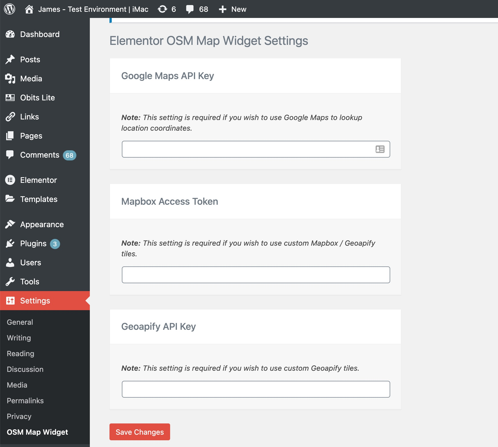
3. Add the **OSM Map** widget to an Elementor page:
    - Find the OSM Map widget in the elements list and add it to your page.<br />
      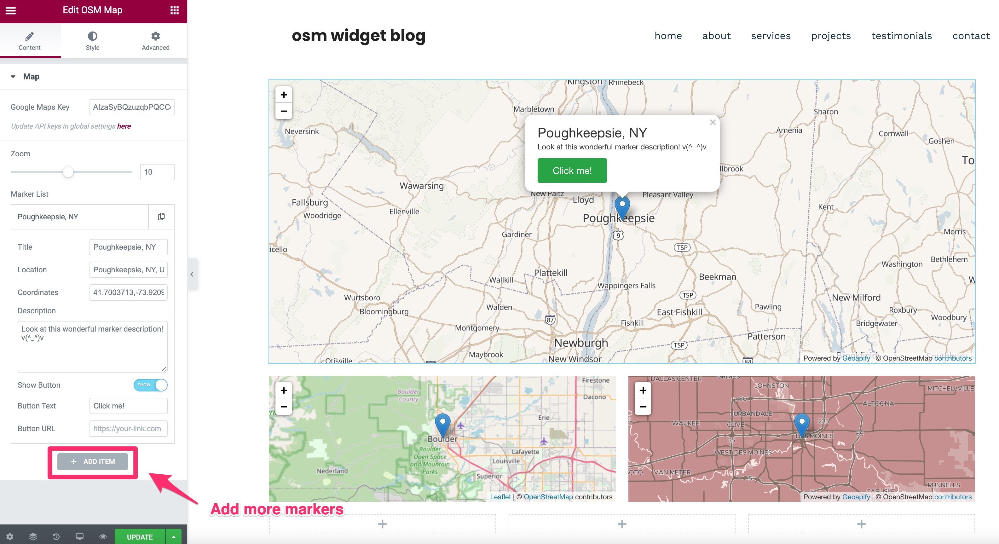
    - **Markers:** add items to the marker list and style them.<br />
      
    - Each item's **Type** is Point, Rectangle, Circle, Polygon, Line, GeoJSON or Route. A Point needs only its **Coordinates**; with a Google Maps API key they can be filled in automatically from the location. The other types ask for their own corners, points or stops.<br />
      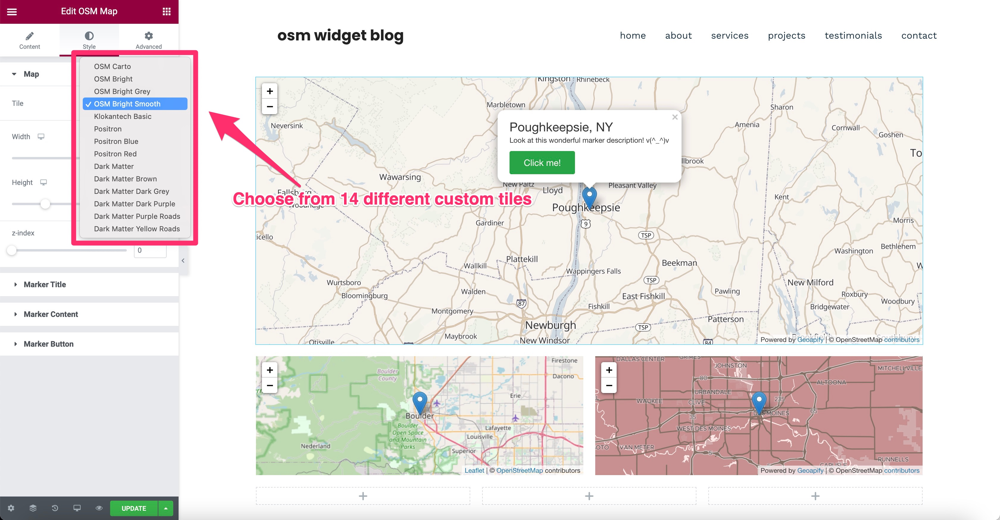
    - **Marker icons:** Default, Font Awesome or Custom Image.<br />
      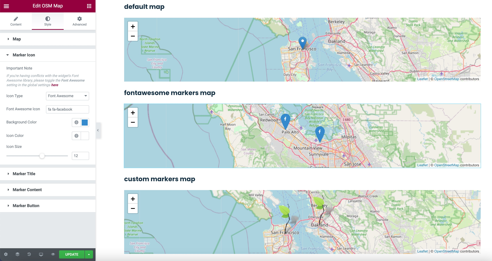
    - **Map styles:** change the tiles from the Style tab _(the Geoapify styles need the **Geoapify API Key** and **Mapbox Access Token**)_.<br />
      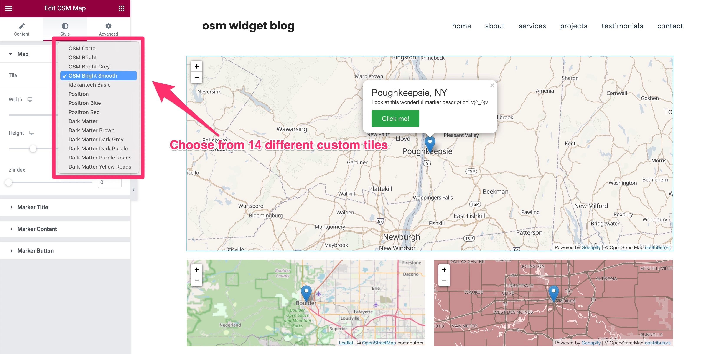
    - **Map Center:** choose **Midpoint of markers**, **Fit all markers** or **Custom coordinates**, and set the zoom level per device.<br />
      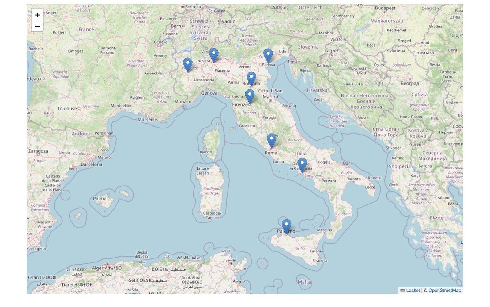<br />
      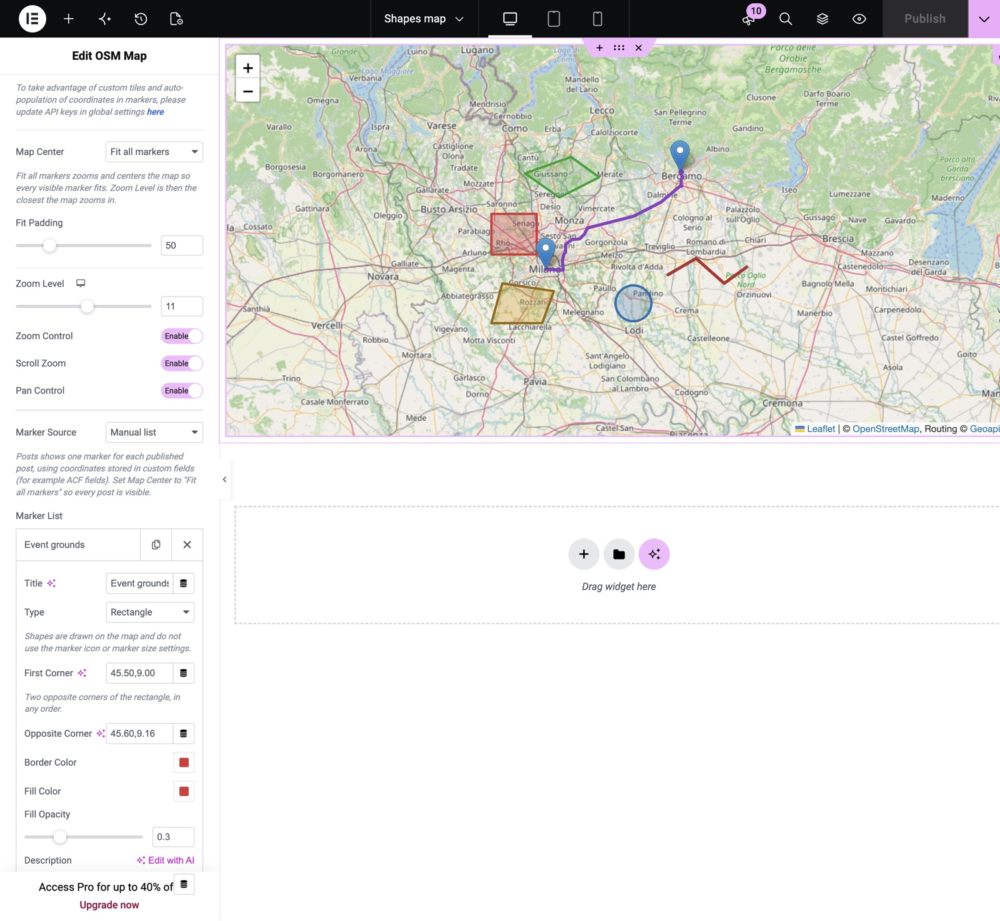
    - **Shapes:** rectangles, circles, polygons, lines and pasted GeoJSON, each with its own colors and popup.<br />
      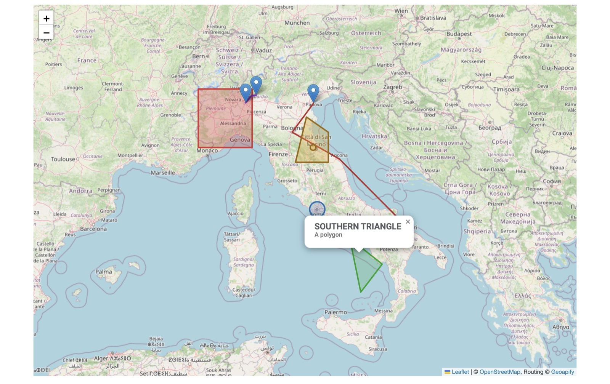
    - **Routes:** set the Type to Route and enter a start, an end and optional stops. The route follows roads, with distance and time in the popup _(needs the **Geoapify API Key**; without it the route is a dashed straight line)_.<br />
      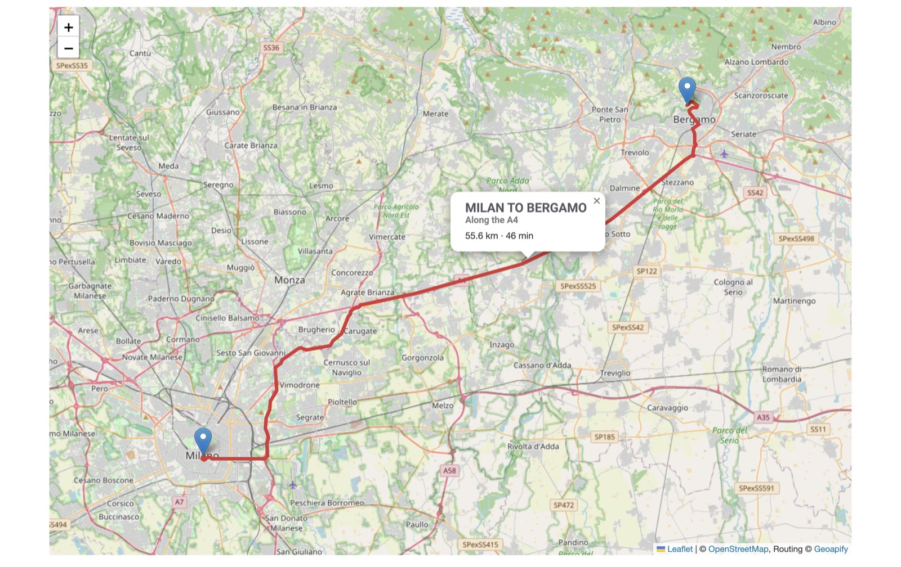<br />
      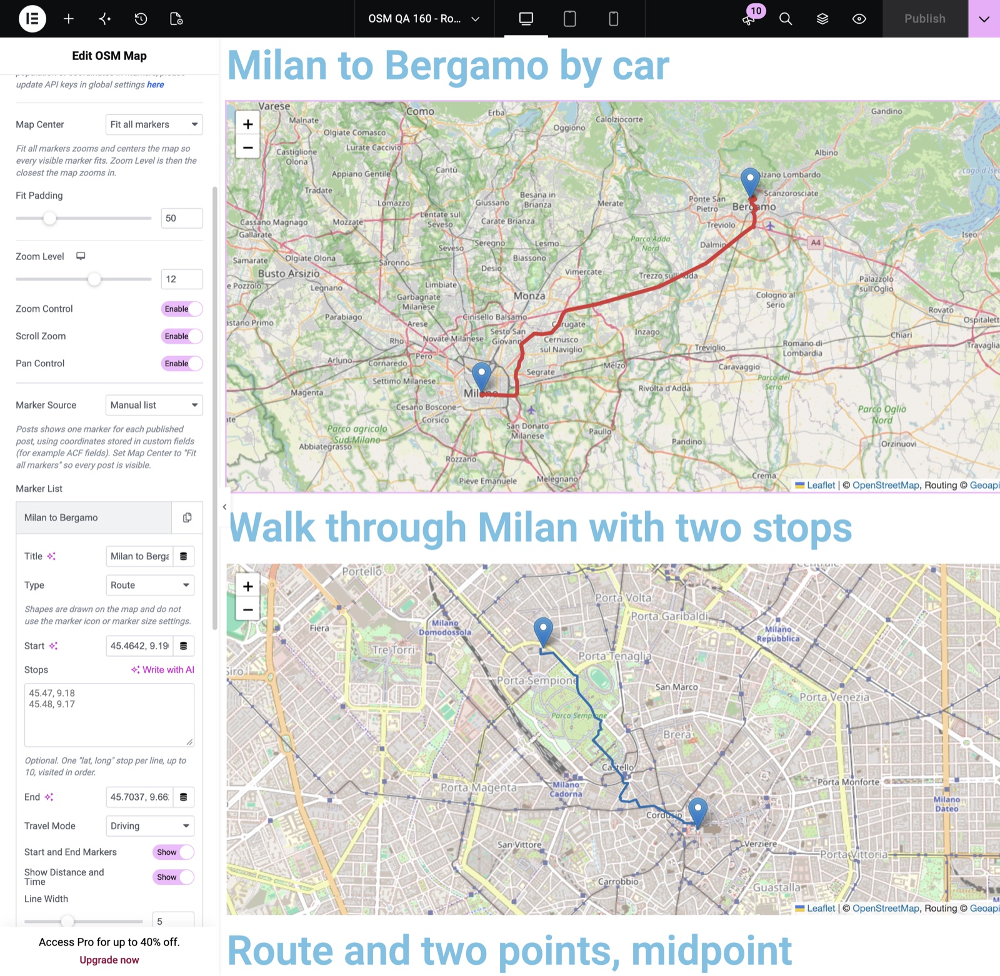
    - **Marker Source:** set it to **Posts** to build the markers from your posts, with coordinates from custom fields such as ACF fields.<br />
      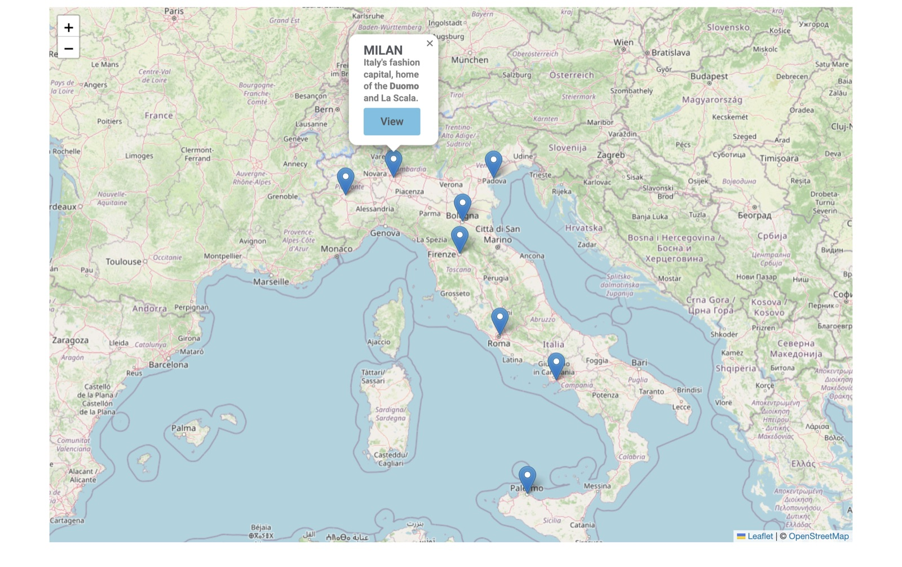

## External services
Maps load tiles from OpenStreetMap, Stadia Maps, Geoapify or your own tile server in the visitor's browser. Routes are fetched from the Geoapify Routing API by your server and cached. See the **External services** section of [readme.txt](readme.txt) for what each service receives.

## Development
Tests run with PHPUnit under [wp-env](https://developer.wordpress.org/block-editor/reference-guides/packages/packages-env/):

```bash
npx @wordpress/env start && npx @wordpress/env run tests-cli --env-cwd=wp-content/plugins/osm-map-elementor composer test
```

## Changelog
[LATEST CHANGES](https://github.com/flopperj/osm-map-elementor/wiki/Changelog)

## Licence
[GNU GENERAL PUBLIC LICENSE](https://raw.githubusercontent.com/flopperj/osm-map-elementor/main/LICENSE.txt)

[OpenStreetMap License](https://www.openstreetmap.org/copyright)
